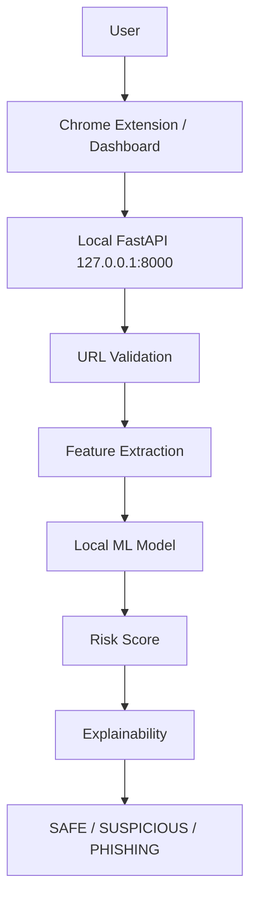
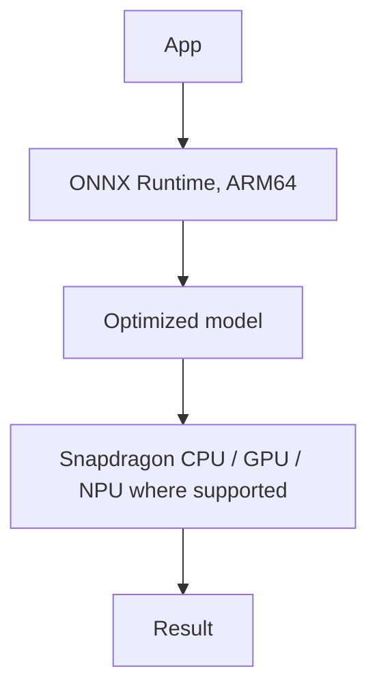

# SnapShield — On-Device Explainable Phishing Detection

SnapShield classifies a URL as **SAFE / SUSPICIOUS / PHISHING**, gives a risk score, and explains *why*. Analysis is pure string analysis by a lightweight local ML model. URLs are never fetched and no cloud AI API is used.

> **Honesty statement.** Developed on an Intel Core i5-13420H laptop. **Not tested or benchmarked on Snapdragon hardware.** No Qualcomm certification or endorsement is claimed. This repository contains **no pre-filled metrics**: every number comes from running the commands below on your machine.

## Status

| Item | Status |
|---|---|
| Feature extractor + URL validation | Implemented; core logic checked by hand-run assertions |
| FastAPI backend, dashboard, Chrome extension | Implemented; **must be run/loaded by you to verify** (see checklist) |
| Dataset prep, training, evaluation, benchmark, ONNX export | Implemented; **not yet executed** (dataset needs internet download) |
| API tests (`pytest`) | Written (stub model for contract tests; real-model test auto-skips until trained) |
| Snapdragon deployment | **PLANNED ONLY** — see `docs/snapdragon_deployment.md` |

## Architecture

Snapdragon target (planned):


## Dataset
PhiUSIIL Phishing URL Dataset (UCI ML Repository #967), ~235k labeled URLs. Listed as CC BY 4.0 — confirm on the dataset page and cite the authors. Only the URL string is used. Duplicates are dropped and train/val/test are split **grouped by hostname** to reduce leakage. Known caveat: dataset-collection artifacts (e.g. scheme/`www` patterns) can make lexical models look better than they will on arbitrary real-world URLs; treat results as dataset-specific.

## Model & explainability
`ml/train.py` trains Logistic Regression, Random Forest and Gradient Boosting on 30 lexical features and keeps the best by **validation F1**. Thresholds (`SUSPICIOUS ≥ 0.35`, `PHISHING ≥ 0.70`, env-overridable) are **application-level defaults, not scientifically universal, and uncalibrated** — `ml.evaluate` reports how the real test set falls into the three bands so you can tune them.

Explanations use single-feature ablation against the median legitimate-URL value (see `backend/services/explainer.py`): a reason appears only if resetting that feature to the safe baseline measurably lowers the model's risk score. SHAP was not used to keep dependencies light. Limitation: correlated features share credit non-additively.

## Setup and run (Windows PowerShell)
```powershell
python -m venv .venv
.\.venv\Scripts\Activate.ps1
pip install -r backend/requirements.txt

# 1. Download dataset CSV into dataset/raw/ (instructions in ml/prepare_dataset.py)
python -m ml.prepare_dataset
python -m ml.train
python -m ml.evaluate        # -> reports/model_metrics.json, model_evaluation.txt, confusion_matrix.png
python -m ml.export_onnx     # -> backend/models/phishing_model.onnx, reports/onnx_comparison.json
python -m ml.benchmark       # -> reports/local_benchmark.json (LOCAL INTEL benchmark)
pytest
python run.py                # Dashboard http://127.0.0.1:8000  | Swagger http://127.0.0.1:8000/docs
```
Use ONNX at runtime: `$env:SNAPSHIELD_USE_ONNX="1"; python run.py`.

**Chrome extension:** `chrome://extensions` → Developer mode → *Load unpacked* → select `extension/`. Start `python run.py` first; if the backend is offline the popup says so.

## Results
Run `python -m ml.evaluate` and paste the real values from `reports/model_metrics.json` here: *(intentionally empty until you run it)*.

## Privacy & security
URLs go only to `127.0.0.1`. Only http(s) URLs ≤2048 chars are accepted; request bodies >4 KB are rejected; submitted URLs are never fetched or executed; logs record hostname and class only; CORS is limited to localhost and extension origins.

## Limitations
Lexical-only analysis (no page content, WHOIS, reputation feeds); dataset bias; uncalibrated thresholds; explanations are approximations; the extension scans only when the popup is opened.

## Verification checklist (do before submitting)
`pip install` ✔ → prepare → train → evaluate → `/api/v1/health` → predict via `/docs` → dashboard → load extension → `pytest` → benchmark → ONNX export. Add screenshots to `screenshots/` from your real run.
